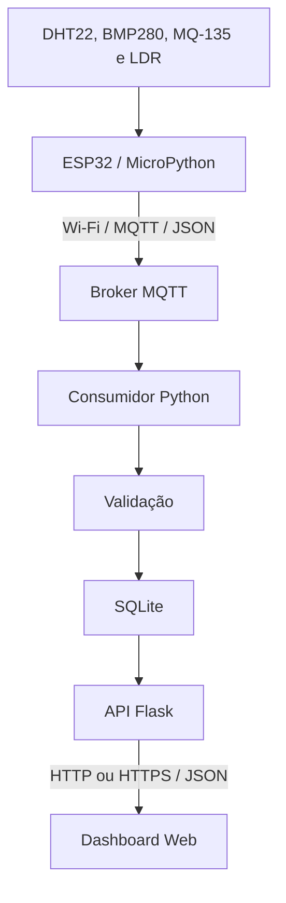

# Estação Meteorológica IoT — Firmware ESP32

**Vídeo de demonstração:** inserir link do vídeo.

**Dashboard:** https://estacao-meteorologica-front.onrender.com

## Sobre o projeto

Projeto acadêmico de uma estação meteorológica para monitoramento ambiental local, desenvolvido na disciplina Projeto e Desenvolvimento II.

O sistema utiliza um ESP32 para coletar dados de quatro sensores e transmitir mensagens JSON por MQTT. Um backend Python recebe, valida e armazena as informações, disponibilizando-as para um dashboard web.

A proposta relaciona Internet das Coisas e Cidades Inteligentes ao permitir a observação de condições ambientais em uma localização específica.

O protótipo não realiza previsão meteorológica e não substitui equipamentos certificados.

## Arquitetura



O ESP32 publica no broker MQTT. O consumidor Python recebe as mensagens e grava as leituras no banco. A API Flask disponibiliza os registros para o frontend.

## Hardware utilizado

- ESP32 DevKit com módulo ESP-WROOM-32.
- Sensor DHT22.
- Sensor BMP280.
- Módulo MQ-135.
- Módulo LDR com saída digital.
- Protoboard.
- Jumpers.
- Resistores para condicionamento de sinal.
- Alimentação USB para o ESP32.
- Alimentação de 5 V para o MQ-135.

## Pinagem

| Componente | Sinal | Conexão |
| --- | --- | --- |
| DHT22 | DATA | GPIO 4 |
| BMP280 | SDA | GPIO 21 |
| BMP280 | SCL | GPIO 22 |
| BMP280 | CSB | 3,3 V para operação I²C |
| BMP280 | SDO | GND para endereço 0x76 |
| LDR | DO | GPIO 27 |
| MQ-135 | AO, após divisor de tensão | GPIO 34 |
| MQ-135 | DO | Não utilizado |

### Alimentação e condicionamento

DHT22, BMP280 e LDR utilizam alimentação de 3,3 V na montagem prevista. O MQ-135 utiliza alimentação de 5 V, com GND comum ao ESP32.

A saída analógica do MQ-135 deve passar por um divisor de tensão antes de chegar ao GPIO 34. A configuração de atenuação do ADC não protege o pino contra sobretensão.

Para dois resistores de 10 kΩ:

```text
AO do MQ-135 → resistor de 10 kΩ → ponto de leitura → resistor de 10 kΩ → GND
                                      |
                                   GPIO 34
```

O cálculo nominal é:

```text
V_ADC = V_AO × R_inferior / (R_superior + R_inferior)

V_ADC = V_AO / 2
```

Assim, uma saída de 5 V resulta nominalmente em 2,5 V no ponto de leitura.

O DHT22 avulso necessita de resistor pull-up no sinal. Verificar se o módulo utilizado já possui esse componente.

Confirmar as conexões e os valores efetivamente utilizados no esquemático final. Alterar a montagem somente com as alimentações desligadas.

## Estrutura do repositório

| Arquivo | Responsabilidade |
| --- | --- |
| `main.py` | Ciclo de coleta, conexão Wi-Fi e publicação MQTT |
| `sensores.py` | Aquisição e tratamento de falhas dos sensores |
| `bmp280.py` | Driver do BMP280 |
| `teste_sensores.py` | Teste da coleta integrada |
| `teste_bmp280.py` | Teste isolado do BMP280 |
| `teste_ldr.py` | Teste isolado do LDR |
| `teste_mq135.py` | Teste isolado do MQ-135 |

O arquivo `credenciais.py` deve ser criado pelo usuário e salvo na placa. Credenciais reais não devem ser publicadas no repositório.

## Ambiente de desenvolvimento

- Thonny IDE.
- MicroPython para ESP32.
- MicroPython 1.29.0 utilizado durante o desenvolvimento.
- Pacote `umqtt.simple`.

Os módulos `machine`, `network` e `dht` são utilizados no ambiente MicroPython da placa. O firmware não deve ser executado pelo interpretador Python do computador.

## Instalação

1. Instalar MicroPython compatível com a placa ESP32.
2. No Thonny, selecionar o interpretador **MicroPython (ESP32)**.
3. Selecionar a porta USB correspondente à placa.
4. Instalar ou copiar o pacote `umqtt.simple` para o ESP32.
5. Criar o arquivo `credenciais.py`:

```python
WIFI_NOME = "NOME_DA_REDE"
WIFI_SENHA = "SENHA_DA_REDE"
```

6. Salvar na raiz do ESP32:

```text
main.py
sensores.py
bmp280.py
credenciais.py
```

7. Usar **Parar/Reiniciar** no Thonny para recarregar os módulos.
8. Executar `main.py`.

Manter também uma cópia atualizada do código no computador e no repositório. Alterar somente a cópia local não atualiza automaticamente o arquivo salvo na placa.

Com `main.py` salvo na raiz do ESP32, o programa é executado na inicialização da placa.

## Configuração MQTT

| Parâmetro | Valor |
| --- | --- |
| Broker | `test.mosquitto.org` |
| Porta | `1883` |
| QoS | `0` |
| Retain | `False` |
| Keepalive | `60` segundos |

O tópico é gerado a partir do identificador da placa:

```text
pi-meteorologia/<identificador_da_placa>/leituras
```

Na montagem utilizada:

```text
pi-meteorologia/781c3cda41d0/leituras
```

Ao trocar de placa, conferir o tópico impresso no console e atualizar a configuração do consumidor.

O broker público é utilizado sem autenticação e sem TLS nesta configuração. Trata-se de uma configuração de demonstração, sem garantia de disponibilidade.

## Frequência de coleta

O parâmetro abaixo está definido em `main.py`:

```python
INTERVALO_LEITURA_S = 3
```

O programa aguarda três segundos após cada ciclo. O período total também inclui o tempo de leitura e comunicação.

## Contrato JSON

Exemplo ilustrativo de mensagem versão 3:

```json
{
  "versao": 3,
  "estacao_id": "estacao-01",
  "sequencia": 1,
  "leituras": {
    "temperatura_c": 26.2,
    "umidade_pct": 68.3,
    "pressao_hpa": 925.7,
    "mq135_adc": 240,
    "luminosidade_adc": null,
    "luminosidade_digital": 0
  },
  "estado_sensores": {
    "dht22": "ok",
    "bmp280": "ok",
    "mq135": "ok",
    "ldr": "ok"
  }
}
```

### Interpretação dos campos

| Campo | Significado |
| --- | --- |
| `versao` | Versão do contrato de comunicação |
| `estacao_id` | Identificação da estação |
| `sequencia` | Contador reiniciado junto com o firmware |
| `temperatura_c` | Temperatura em graus Celsius |
| `umidade_pct` | Umidade relativa em porcentagem |
| `pressao_hpa` | Pressão atmosférica em hPa |
| `mq135_adc` | Contagem bruta do ADC, de 0 a 4095 |
| `luminosidade_adc` | Campo legado, mantido como `null` |
| `luminosidade_digital` | Resultado digital do módulo LDR |

O MQ-135 não fornece ppm ou índice certificado de qualidade do ar nesta implementação.

O LDR não mede lux. Na montagem testada, 0 correspondeu ao sensor descoberto e 1 ao sensor coberto. O resultado depende do limiar ajustado no módulo.

## Tratamento de falhas

Falhas tratadas de um sensor produzem valores `null` para seu grupo e estado `erro_leitura`, preservando as leituras dos demais sensores.

O backend aceita os estados:

- `ok`.
- `erro_leitura`.
- `nao_configurado`.
- `aquecendo`.

O firmware atual não implementa temporização de aquecimento.

Em `sensores.py`, os parâmetros abaixo permitem desabilitar a aquisição:

```python
LDR_HABILITADO = False
MQ135_HABILITADO = False
```

Quando desabilitado, o sensor retorna `null` e estado `nao_configurado`.

O estado `ok` indica que a aquisição foi aceita pelo código. Não comprova presença física, calibração ou precisão do sensor. Entradas desconectadas podem produzir valores digitais ou analógicos sem gerar exceções.

## Confirmar recepção MQTT

Em um computador com `mosquitto_sub` instalado:

```bash
mosquitto_sub -h test.mosquitto.org -p 1883 \
  -t "pi-meteorologia/781c3cda41d0/leituras" -v
```

Abrir o assinante antes das publicações, pois as mensagens não são retidas.

A confirmação de recepção deve ser feita no assinante ou no backend. O log “Publicação enviada” não substitui essa evidência.

## Testes recomendados

- Leitura isolada de cada sensor.
- Coleta com os sensores conectados simultaneamente.
- Continuidade das publicações após falha de um sensor.
- Recepção das mensagens pelo assinante MQTT.
- Interrupção e restabelecimento da rede.
- Retomada automática da publicação sem reinicialização manual.

Registrar o resultado efetivamente observado. A existência de código de reconexão não comprova que todos os cenários de recuperação foram aprovados.

## Limitações

- Coleta periódica e bloqueante.
- Sem fila persistente para mensagens não enviadas.
- QoS 0, sem garantia de entrega.
- MQ-135 sem calibração ou conversão para ppm.
- LDR com saída exclusivamente digital.
- Sem pluviômetro.
- Sem interrupções externas ou debounce.

Pluviômetro, interrupções e debounce aparecem no roteiro acadêmico, mas não estão implementados nesta versão.

## Documentação visual

Acrescentar os seguintes materiais:

- Esquemático elétrico com alimentação, resistores e GPIOs.
- Foto da montagem final.
- Captura dos logs de coleta.
- Evidência da recepção MQTT.
- GIF ou vídeo curto do funcionamento integrado.

Sugestão de organização:

```text
docs/
  esquematico.png
  prototipo.jpg
  coleta.png
  mqtt.png
  demonstracao.gif
```

Os nomes acima são sugestões; inserir os arquivos reais antes de criar os links.

## Repositórios relacionados

- Firmware: https://github.com/Shamoleambo/ESP32
- Backend: https://github.com/Shamoleambo/ESP32-backend
- Frontend: https://github.com/Shamoleambo/ESP32-frontend
